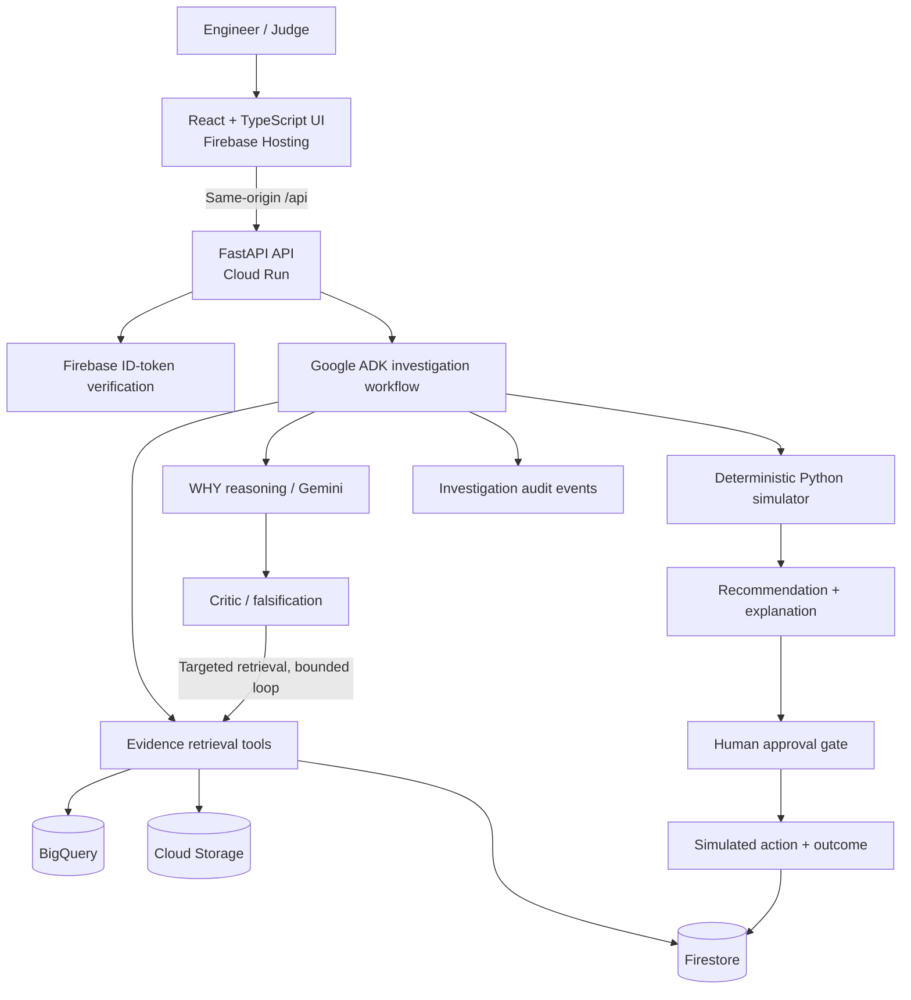

<div align="center">

# FACTORY WHY

### From anomaly to accountable action.

**An evidence-grounded, agentic AI workspace for industrial root-cause investigation and decision support.**

[](https://cloud.google.com/run)
[](https://ai.google.dev/)
[](https://google.github.io/adk-docs/)
[](https://firebase.google.com/)
[](https://react.dev/)

**[🚀 Live Demo](https://factory-why-hackathon.web.app)** · **[📂 Source Code](https://github.com/Akhil-Anupoju/factory-why)** · **[📖 Deployment Runbook](docs/deployment.md)**

*Built for the Google Cloud AI Builder Cup 2026.*

</div>

---

## The problem

Factories have no shortage of alarms. A vibration spike, a temperature rise, or an abnormal motor-current reading can tell an engineer **what changed**. It rarely explains **why it changed**, whether the apparent cause is correct, or which response balances risk, downtime, and cost.

The relevant evidence is often scattered across telemetry, maintenance logs, previous incidents, service manuals, and inspection images. Under time pressure, teams can anchor on the first plausible explanation and take action before checking contradictory evidence.

**Factory WHY closes the gap between detection and decision.** It turns a machine alert into a traceable investigation, compares plausible causes, challenges assumptions, and supports a controlled human decision.

> **Not another anomaly detector. Not a chatbot that guesses the cause. A structured investigation workflow that asks: _What would prove this explanation wrong?_**

## At a glance

| Question | Factory WHY's answer |
| --- | --- |
| **What happened?** | Reconstruct the machine state and abnormal signals. |
| **Why might it have happened?** | Generate competing, evidence-linked root-cause hypotheses. |
| **What could disprove the leading theory?** | Run a Critic pass and identify contradictory or missing evidence. |
| **What should we do next?** | Compare deterministic Continue / Inspect / Repair scenarios. |
| **Who decides?** | An authenticated engineer approves, rejects, or requests further evidence. |
| **What happened afterward?** | Record the simulated action, outcome, and investigation audit trail. |

## Product experience: Observe → Explain → Decide → Record

| Phase | Engineer experience | System behavior |
| --- | --- | --- |
| **01 · Observe** | Select an incident; inspect the machine, telemetry, and timeline. | Retrieve sensor anomalies, maintenance events, and supporting context. |
| **02 · Explain** | Compare root-cause hypotheses; challenge the leading theory. | Gemini reasons over evidence; ADK coordinates retrieval, WHY, and Critic steps. |
| **03 · Decide** | Compare intervention options and review the recommendation. | Python computes scenario outcomes; Gemini explains the trade-offs. |
| **04 · Record** | Approve a controlled action; inspect the result and audit trail. | Persist decisions, simulated actions, and evaluation outcomes. |

The interface is designed to make the investigation readable first, with deeper evidence and execution details available on demand. The workflow is intentionally **human-in-the-loop**.

## A representative investigation

**Scenario: CNC-04 spindle vibration anomaly**

A CNC machine shows a **42% increase in vibration**, an **11% increase in temperature**, and an **8% increase in motor current**. A spindle bearing was replaced four days earlier. The maintenance record does not clearly establish whether alignment was verified.

1. **Observe:** Assemble telemetry, recent maintenance, historical incidents, and relevant manual excerpts.
2. **Explain:** Evaluate bearing misalignment, lubrication issues, and a possible sensor fault as competing hypotheses.
3. **Challenge:** Ask what evidence would weaken the leading explanation. The Critic identifies the missing alignment measurement.
4. **Retrieve:** Add the targeted inspection result and reassess the hypotheses.
5. **Decide:** Compare continuing production, inspecting the machine, and repairing immediately using a deterministic scenario model.
6. **Record:** Require human authorization before recording a **simulated** maintenance action, then compare the prediction with the synthetic ground truth.

This is a **synthetic hackathon scenario**, not a claim about a real factory asset. The repository may also include test fixtures for `INC-2026-0902`; consult `docs/test-incidents-firestore.md` for the supported seed workflow and use disposable incident IDs for action tests.

## System architecture



**Separation of concerns matters:** Google ADK orchestrates the agent workflow; Gemini supplies reasoning; application code executes allowlisted tools; Python calculates numeric scenarios; Firebase and Google Cloud manage identity, hosting, state, and evidence. No model output is treated as authorization to perform a real industrial action.

### Google technology stack

| Technology | Responsibility |
| --- | --- |
| **Gemini 2.5 Flash via Vertex AI** | Structured hypothesis generation, evidence-based explanation, and Critic reasoning. |
| **Google Agent Development Kit (ADK)** | Orchestration of investigation, evidence tools, critique, and bounded revision. |
| **Cloud Run** | Containerized FastAPI backend, scalable to zero when idle. |
| **Cloud Build + Artifact Registry** | Remote backend image build and storage. |
| **Firebase Hosting** | Production hosting for the React/Vite single-page application. |
| **Firebase Authentication** | Google sign-in and user identity for protected workflows. |
| **Cloud Firestore** | Incidents, hypotheses, evidence references, decisions, and outcomes. |
| **BigQuery** | Industrial telemetry and evaluation-oriented analysis. |
| **Cloud Storage** | Manuals, images, and supporting evidence artifacts. |
| **Cloud Logging** | Runtime diagnostics and operational troubleshooting. |
| **Google AI Studio** | Prompt, schema, and model-behavior experimentation during development. |

> **Development tooling vs product runtime:** Claude Code with OmniRoute can help contributors write and test code. It is not the deployed agent orchestration layer. The product backend uses **Google ADK + Gemini / Vertex AI**.

## Agentic design

Factory WHY uses **purposeful agents and tools**, rather than an unbounded multi-agent swarm.

- **Evidence retrieval:** Collect relevant telemetry, maintenance history, prior incidents, manuals, and available images through narrowly scoped tools.
- **WHY reasoning:** Produce multiple candidate causes, each with supporting evidence, contradictory evidence, uncertainty, and evidence IDs.
- **Critic:** Identify weak assumptions, contradictions, and the most informative missing check.
- **Targeted revision:** Retrieve additional evidence where available and revise the explanation, with a bounded number of passes.
- **Decision support:** Explain results from deterministic simulations without inventing numerical calculations.
- **Approval and action:** Preserve the human decision and record a simulated, auditable outcome.

The key design principle is **evidence before conclusions**. A persuasive narrative is not a substitute for an evidence reference.

## Decision simulation

The prototype compares predefined intervention strategies:

| Option | Purpose |
| --- | --- |
| **Continue** | Estimate the risk and production impact of operating without intervention. |
| **Inspect** | Estimate the cost and value of a targeted diagnostic check. |
| **Repair** | Estimate the trade-off of immediate maintenance. |

Downtime, cost, and risk figures come from **deterministic Python logic and scenario assumptions**, not free-form LLM arithmetic. The model's job is to interpret and communicate the trade-offs. Simulation outputs are **illustrative decision-support estimates**, not validated safety predictions.

## Getting started locally

### Prerequisites

- Git
- Node.js compatible with the repository's Vite version (Node.js **22.12+** or a compatible newer release)
- npm
- Python **3.12** for the backend (matches the deployed backend image)
- A Firebase web app configuration
- Google Cloud credentials or the supported local backend mode

### 1. Clone

```bash
git clone https://github.com/Akhil-Anupoju/factory-why.git
cd factory-why
```

### 2. Configure the frontend

Create `.env.local` at the repository root:

```dotenv
VITE_FIREBASE_API_KEY="YOUR_FIREBASE_WEB_API_KEY"
VITE_FIREBASE_AUTH_DOMAIN="factory-why-hackathon.firebaseapp.com"
VITE_FIREBASE_PROJECT_ID="factory-why-hackathon"
VITE_FIREBASE_STORAGE_BUCKET="factory-why-hackathon.firebasestorage.app"
VITE_FIREBASE_MESSAGING_SENDER_ID="YOUR_MESSAGING_SENDER_ID"
VITE_FIREBASE_APP_ID="YOUR_FIREBASE_APP_ID"
VITE_API_BASE_URL="http://localhost:8000"
```

The exact API base URL depends on your local proxy configuration. Use the repository's existing Vite/API settings if they differ. Firebase web configuration is public client configuration; **server credentials are not**.

```bash
npm ci
npm run dev
```

Open **http://localhost:3000** (the repository's Vite dev port).

### 3. Run the backend

The deployed backend uses Python, FastAPI, and Google ADK. From the repository root:

```bash
python3.12 -m venv backend/.venv
source backend/.venv/bin/activate
python -m pip install -e ./backend
```

For **local Vertex AI access**, authenticate and select the project:

```bash
gcloud auth application-default login
gcloud auth application-default set-quota-project factory-why-hackathon
export GOOGLE_GENAI_USE_VERTEXAI=true
export GOOGLE_CLOUD_PROJECT=factory-why-hackathon
export GOOGLE_CLOUD_LOCATION=asia-south1
```

Then run the API, using the entry point shown in the deployment image:

```bash
python -m uvicorn backend.app.main:app --host 127.0.0.1 --port 8000 --reload
```

The local backend may require additional environment variables for Firestore, BigQuery, Cloud Storage, CORS, and runtime mode. Refer to `docs/factory-why-environment.md` and the backend configuration rather than copying production credentials into source code. Local access to cloud data also requires appropriate IAM permissions.

### 4. Run checks

```bash
npm run lint
npm test
npm run build
backend/.venv/bin/python -m pytest -q backend/tests
```

**Note:** The frontend and backend commands assume the repository layout described in the supplied deployment runbook. If the repository has evolved, check the current scripts and package manifests before running them.

## Docker and deployment

The production deployment is deliberately simple: **Cloud Build builds the backend remotely**, Cloud Run hosts the API, and Firebase Hosting serves the frontend.

### Prerequisites

- `gcloud` CLI and Firebase CLI
- Access to project `factory-why-hackathon`
- An enabled billing account and required service APIs
- Permission to deploy Cloud Run and attach the existing runtime service account
- Firebase web app configuration exported in the current shell

**Existing production configuration**

| Setting | Value |
| --- | --- |
| GCP project | `factory-why-hackathon` |
| Cloud Run region | `asia-south1` |
| Cloud Run service | `factory-why-api` |
| Runtime service account | `factory-why-runtime@factory-why-hackathon.iam.gserviceaccount.com` |
| Model | `gemini-2.5-flash` through Vertex AI |
| Backend health route | `/api/health` |
| Frontend | `https://factory-why-hackathon.web.app` |

### Deploy backend

```bash
gcloud auth login
gcloud config set project factory-why-hackathon
GCP_PROJECT=factory-why-hackathon GCP_REGION=asia-south1 \
  bash scripts/deploy-backend-gcp.sh
```

The backend script builds a container with Cloud Build, pushes it to Artifact Registry, and deploys `factory-why-api` to Cloud Run. Docker Desktop is **not required** for the remote Cloud Build path.

Verify:

```bash
SERVICE_URL=$(gcloud run services describe factory-why-api \
  --project=factory-why-hackathon --region=asia-south1 \
  --format='value(status.url)')
curl -i "${SERVICE_URL}/api/health"
```

### Deploy frontend

```bash
npm install -g firebase-tools
firebase login
# Load only a trusted local environment file containing the required VITE_FIREBASE_* values:
set -a
source .env.local
set +a
GCP_PROJECT=factory-why-hackathon bash scripts/deploy-frontend-firebase.sh
```

The script runs `npm ci`, builds Vite with production runtime settings, and deploys Firebase Hosting. Hosting rewrites `/api/**` to the Cloud Run service, so production browser requests can use same-origin `/api` routes.

**Pushing to GitHub does not automatically deploy this application** unless a separate CI/CD trigger has been configured. Frontend-only changes require a Firebase Hosting deployment; backend or Cloud Run runtime configuration changes require a backend deployment.

For one-time IAM setup, APIs, secrets, and verification, see **[`docs/deployment.md`](docs/deployment.md)**. Treat that runbook as the operational source of truth.

## Incident data and evaluation

Factory WHY uses **synthetic incident fixtures** to exercise the workflow without connecting to real factory machinery. One representative case is `INC-2026-0902`, involving CNC-04, abnormal telemetry, recent bearing maintenance, and a missing alignment check.

Recommended validation sequence:

1. Load a fresh pending synthetic incident.
2. Confirm machine context, telemetry, maintenance events, and evidence IDs.
3. Run WHY reasoning and inspect competing hypotheses.
4. Trigger the live Critic / challenge workflow.
5. Request targeted evidence and check that the hypothesis is revised appropriately.
6. Compare Continue, Inspect, and Repair scenarios.
7. Record a human decision and execute **only a simulated** action.
8. Inspect the outcome and audit trail; compare predictions with fixture ground truth.

**Keep the expected answer hidden from the reasoning context.** Ground-truth fixtures should be used for evaluation, not supplied to Gemini as investigation evidence.

See [`docs/test-incidents-firestore.md`](docs/test-incidents-firestore.md) for the repository's targeted Firestore seeding instructions. The runbook notes that seeding is dry-run by default; review IDs and the target project before writing data.

### What to evaluate

- **Evidence grounding:** Do material claims cite valid evidence IDs?
- **Hypothesis diversity:** Does the system consider plausible alternatives?
- **Falsification quality:** Does the Critic find meaningful contradictory or missing evidence?
- **Revision behavior:** Does new evidence change the explanation when warranted?
- **Decision consistency:** Do recommendations match deterministic scenario outputs?
- **Authorization:** Are approval and action boundaries enforced server-side?
- **Traceability:** Can a reviewer reconstruct the investigation from audit events?

These are **evaluation goals**; this README does not claim benchmark scores that have not been measured.

## Security, safety, and responsible AI

- **Human control:** No autonomous real-world maintenance dispatch or machine control is part of the hackathon prototype.
- **Server-side authorization:** Protected approval and action endpoints must verify Firebase ID tokens and enforce permissions independently of the UI.
- **Demo isolation:** Browser-only demo actions must be clearly distinguished from server-backed decisions.
- **Secrets:** Never commit Gemini keys, service-account JSON, `.env.local`, or private evidence. Cloud Run should use its attached service account and Secret Manager where needed.
- **Evidence provenance:** Distinguish observations, hypotheses, assumptions, and ground truth.
- **Uncertainty:** Treat confidence and simulated outcomes as decision-support signals, not certified reliability or safety guarantees.
- **Least privilege:** Scope service-account permissions to the resources the backend needs.
- **Synthetic data:** Use disposable incidents when exercising approval and action flows.

**This project is a hackathon prototype, not a production-certified industrial safety system.** Recommendations require qualified human review and should not be used to control real equipment without independent engineering validation.

## Troubleshooting

| Symptom | Check |
| --- | --- |
| Frontend loads but `/api` returns HTML | Firebase Hosting rewrite order and service ID in `firebase.json`. |
| `/api/health` fails | Cloud Run revision health, port binding, and service logs. |
| Firebase login fails | Auth provider, authorized domains, and Firebase web config. |
| Protected API returns `401` | Firebase ID token acquisition and server-side verification. |
| Gemini/ADK request fails | Vertex AI permissions, model availability, region, and runtime configuration. |
| Missing incidents or evidence | Firestore data, BigQuery dataset/table, GCS artifacts, and seeding. |
| Frontend changes not visible | Rebuild and redeploy Firebase Hosting; refresh cached browser assets. |
| Cloud Build permission denied | Build submission permissions and build service-account access. |

```bash
# Cloud Run logs
gcloud run services logs read factory-why-api \
  --project=factory-why-hackathon --region=asia-south1 --limit=100

# Inspect deployed services
gcloud run services list --project=factory-why-hackathon --region=asia-south1
```

## Project documentation

- **[`docs/deployment.md`](docs/deployment.md)** — GCP deployment runbook, runtime identity, and verification.
- **[`docs/factory-why-environment.md`](docs/factory-why-environment.md)** — Environment, IAM, and cloud resource expectations.
- **[`docs/test-incidents-firestore.md`](docs/test-incidents-firestore.md)** — Synthetic incident fixtures and targeted seeding.
- **`scripts/deploy-backend-gcp.sh`** — Cloud Build + Cloud Run deployment.
- **`scripts/deploy-frontend-firebase.sh`** — Vite build + Firebase Hosting deployment.

> Paths above are drawn from the deployment runbook supplied for this project. Confirm they exist on the branch being published; the repository's branches may differ.

## Roadmap

**Hackathon focus:** Reliable end-to-end investigation, real evidence retrieval, bounded ADK critique, deterministic simulation, approval, and a clear audit trail.

**Potential next steps:** Richer multimodal inspection evidence, stronger evaluation suites, role-based review workflows, more asset types, historical incident search, observability dashboards, and integration with maintenance systems behind explicit authorization and safety controls.

These are future directions, not claims of shipped functionality.

## Contributing

Contributions are welcome through the repository's normal GitHub workflow. For a change:

1. Create a focused feature branch.
2. Keep UI, backend, and deployment configuration changes reviewable.
3. Add or update tests for changed behavior.
4. Run lint, tests, and a production build.
5. Open a pull request describing the user impact, test results, and any infrastructure changes.

Do not commit generated credentials or production incident data. For changes to approval, challenge, evidence, or simulation flows, include a regression test that covers the corresponding workflow state.

## Team and acknowledgments

Built as a collaborative **Google Cloud AI Builder Cup 2026** prototype using Google Cloud, Gemini, Google ADK, Firebase, and open-source technologies. Thanks to the contributors improving the investigation experience, backend reliability, synthetic datasets, and deployment workflow.

---

<div align="center">

### FACTORY WHY

**Read the signal. Challenge the explanation. Compare the options. Keep the engineer in control.**

[Live Demo](https://factory-why-hackathon.web.app) · [Repository](https://github.com/Akhil-Anupoju/factory-why)

</div>
